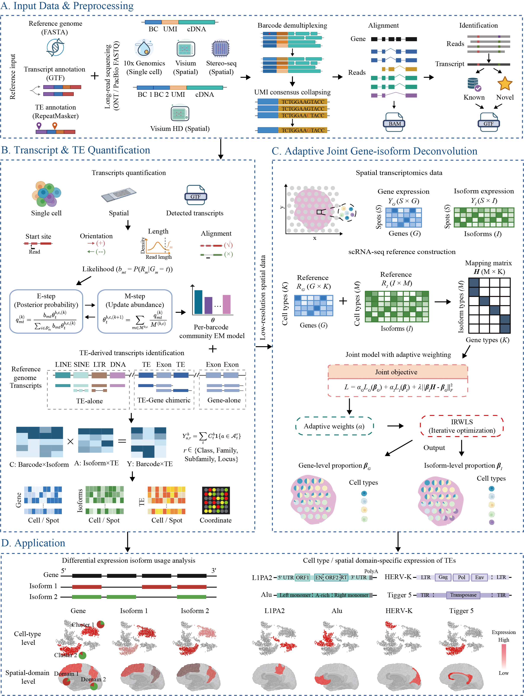

# miniTEQuant — Long-Read RNA Isoform and TE Quantification

miniTEQuant is a long-read RNA-seq isoform quantification tool that supports single-cell (SC) and spatial transcriptomics (ST) analyses. It uses a community-based EM algorithm (expectation-maximization) to estimate isoform abundances from long-read alignments. It also provides transposable element (TE) quantification at the per-cell and per-spot level.

## Table of Contents

- [Features](#features)
- [Installation](#installation)
- [Data Preparation](#data-preparation)
- [Quick Start](#quick-start)
- [Subcommand: `quantify`](#subcommand-quantify)
- [Subcommand: `cal_TE`](#subcommand-cal_te)
- [Module: `sp_tags` (high-resolution spatial barcodes and UMIs)](#module-sp_tags-high-resolution-spatial-barcodes-and-umis)
- [Running Modes](#running-modes)
- [Output Files](#output-files)

---

## Features

- **Multi-mode support**: single-cell (10x Chromium) and spatial transcriptomics (Visium / Visium HD / Stereo-seq)
- **High-resolution spatial preprocessing** (`sp_tags`): for PacBio HiFi and ONT reads, splits concatenated long reads into molecules, identifies spatial IDs (Stereo-seq CID) and UMIs (Stereo-seq MID), corrects them against a whitelist / by UMI clustering, optionally aggregates CIDs into cells (`--barcode2spot`), and writes reads that plug directly into `--st_mode`
- **EM-based isoform quantification**: community-based parallel EM on gene-level bipartite graphs
- **UMI deduplication**: exact-match UMI collapsing in SC/ST modes
- **TE quantification**: annotates transcripts by TE overlap and computes TE expression at locus / subfamily / family / class level for per-cell and per-spot data
 
---

## Installation

```bash
git clone https://github.com/calm109/miniTEQuant.git
cd miniTEQuant
conda env create -f environment.yml
conda activate miniTEQuant
conda install -c bioconda -c conda-forge flexiplex
conda install -c bioconda minimap2
conda install -c bioconda samtools
```

### Additional dependencies for SC / ST modes

| Tool | Purpose | Install |
|------|---------|---------|
| [minimap2](https://github.com/lh3/minimap2) | Long-read genome alignment | `conda install -c bioconda minimap2` |
| [flexiplex](https://davidsongroup.github.io/flexiplex/) | Barcode discovery and demultiplexing | `conda install -c bioconda -c conda-forge flexiplex` |
| [nailpolish](https://github.com/DavidsonGroup/nailpolish) | UMI-based read deduplication and consensus | See below |

> `minimap2` and `flexiplex` install cleanly via conda/bioconda, as shown above. `nailpolish` does not currently ship a conda package, so it is installed separately from a precompiled binary (below). All three are required for the SC/ST barcode → dedup → align pipeline described under [Data Preparation](#data-preparation).

```bash
# nailpolish (Linux precompiled binary)
wget https://github.com/DavidsonGroup/nailpolish/releases/download/nightly_develop/nailpolish
chmod +x nailpolish
mkdir -p ~/bin && mv nailpolish ~/bin/
echo 'export PATH=~/bin:$PATH' >> ~/.bashrc && source ~/.bashrc
```

---

## Data Preparation

### Long-read alignment (all modes)

Use `minimap2` to align long reads to the **reference genome** in spliced mode. Build a `.mmi` index first to speed up repeated runs.

```bash
# Build genome index (do once)
minimap2 -d genome.mmi genome.fa

# ONT cDNA / direct RNA
minimap2 -y -ax splice --MD --secondary=no -G 200k -t 16 genome.mmi reads.fastq.gz > LR.sam

# PacBio HiFi / Iso-Seq
minimap2 -y --secondary=no -ax splice:hq --MD -t 16 genome.mmi reads.fastq.gz \
    | samtools view -b | samtools sort -@ 8 -t CB -O SAM -o LR.sam
```

> **Note:** The `-y` flag propagates read tags (CB, UB) from the FASTQ header into the SAM output — required for SC/ST modes when barcodes are embedded in the read name.

### SC / ST preprocessing: barcode demultiplexing and UMI deduplication

Before alignment, extract and filter barcodes with flexiplex, then deduplicate UMIs with nailpolish.

```bash
# 1. Barcode discovery (generate whitelist)
gunzip -c reads.fastq.gz | flexiplex -d 10x3v3 -f 0 -p 16 > flexiplex.out
flexiplex-filter flexiplex_barcodes_counts.txt > flexiplex_barcodes_final.txt

# 2. Demultiplexing against the whitelist
# If you already have a barcode whitelist (e.g. a spatial barcode whitelist), skip step 1 (Barcode discovery),
# replace flexiplex_barcodes_final.txt with your own whitelist file,
# and run step 2 (Demultiplexing against the whitelist) directly.
gunzip -c reads.fastq.gz | flexiplex -d 10x3v3 -p 16 -k flexiplex_barcodes_final.txt > demux.fastq

# 3. UMI deduplication and consensus generation
nailpolish index --skip-unmatched demux.fastq
nailpolish summary demux.fastq
nailpolish consensus -t 16 demux.fastq > dedup.fastq
```

> For ST (Visium), a spatial barcode whitelist is typically available from Space Ranger output. Pass it directly to flexiplex with `-k` instead of the auto-discovered whitelist.

### High-resolution ST preprocessing (Stereo-seq): `sp_tags`

For Stereo-seq long-read libraries (PacBio HiFi or ONT), use the built-in `sp_tags` module **instead of** flexiplex + nailpolish. In one step it splits concatenated reads into individual molecules, identifies the CID (spatial barcode) and MID (UMI) of each molecule, corrects CIDs against the chip whitelist, corrects MID sequencing errors, and writes a FASTQ ready for minimap2:

```bash
python isoform_quantification/sp_tags/run_sp_tags.py \
    -i reads.fastq.gz \
    -w cid_whitelist.txt \
    -o sp_tags_out \
    -t 16
# -> sp_tags_out/sp_tags.fastq  (align this file with minimap2, then run quantify --st_mode)
# ONT reads: add --data_type nanopore, align with `minimap2 -ax splice -k14`, and run
# sp_tags/run_umi_dedup.py on the alignments before quantify (see "ONT reads" below)
```

See [Module: `sp_tags`](#module-sp_tags-high-resolution-spatial-barcodes-and-umis) for the processing steps, all arguments and output formats, and [ONT reads](#ont-reads-stereo-seq--nanopore) for Stereo-seq + ONT.

### TE annotation preparation (for `cal_TE`)

`cal_TE` requires a TE GTF (`-te_gtf`) built from a RepeatMasker `.out` file. Convert it once with `create_simple_TE_gtf.py`.

**`create_simple_TE_gtf.py`** — Converts RepeatMasker `.out` files to GTF format for TE annotations.

Purpose:
- Handles RepeatMasker `.out` column-width output format
- Generates a standardized GTF with TE hierarchy (`class_id` / `family_id` / `gene_id`=subfamily / `transcript_id`=locus name / `locus`)
- Calculates consensus TE length and truncation proportion from the `rep_start`/`rep_end`/`rep_left` columns

Command:

```bash
python isoform_quantification/TE_analyse/create_simple_TE_gtf.py \
    -i repeatmasker.fa.out \
    -o TE_annotation.gtf
```

Parameters:

| Argument | Description |
|---|---|
| `-i` / `--input` (required) | Input RepeatMasker `.out` file path |
| `-o` / `--output` (required) | Output GTF file path for TE annotations |

The resulting `TE_annotation.gtf` is the `-te_gtf` input for the [`cal_TE` subcommand](#subcommand-cal_te).

---

## Quick Start

### Single-cell mode

```bash
# Step 1–3: demux → dedup → align (see Data Preparation)

# Step 4: isoform quantification
python isoform_quantification/main.py quantify \
    -gtf annotation.gtf \
    -lrsam LR_dedup.sam \
    --sc_mode \
    --no_barcode_in_readname \
    --cb_tag CB --umi_tag UB \
    -t 16 \
    -o output/sc

# Step 5: TE quantification
python isoform_quantification/main.py cal_TE \
    -gtf annotation.gtf \
    -te_gtf TE_annotation.gtf \
    --sc_quant output/sc \
    -t 16 \
    -o output/sc/te
```

### Spatial transcriptomics mode

```bash
# Step 1–3: demux → dedup → align (see Data Preparation)

# Step 4: isoform quantification
python isoform_quantification/main.py quantify \
    -gtf annotation.gtf \
    -lrsam LR_dedup.sam \
    --st_mode \
    --no_barcode_in_readname \
    -t 16 \
    -o output/st

# Step 5: TE quantification
python isoform_quantification/main.py cal_TE \
    -gtf annotation.gtf \
    -te_gtf TE_annotation.gtf \
    --st_quant output/st \
    -t 16 \
    -o output/st/te
```

---

## Subcommand: `quantify`

```
python main.py quantify -gtf <GTF> -o <OUTPUT> [options]
```

### Required arguments

| Argument | Description |
|---|---|
| `-gtf` / `--gtf_annotation_path` | Path to transcript GTF annotation file |
| `-o` / `--output_path` | Output directory |

### Input data (required)

| Argument | Description |
|---|---|
| `-lrsam` / `--long_read_sam_path` | Path to long-read SAM file (genome-aligned) |

### General optional arguments

| Argument | Default | Description |
|---|---|---|
| `-t` / `--threads` | `1` | Number of parallel worker processes |
| `--EM_SR_num_iters` | `200` | Maximum EM iterations |
| `--isoform_start_end_site_tolerance` | `20` | Tolerance (bp) for matching LR read start/end to isoform boundaries |
| `--junction_site_tolerance` | `5` | Tolerance (bp) for matching splice junction sites |
| `--multi_mapping_filtering` | `best` | Multi-mapping filtering strategy: `best` (keep best-scoring alignment) or `unique_only` |

### Mode flags (mutually exclusive)

| Flag | Description |
|---|---|
| `--sc_mode` | Single-cell mode: extracts CB/UMI per read and outputs a cell × isoform count matrix |
| `--st_mode` | Spatial transcriptomics mode: extracts spot barcodes and outputs a spot × isoform count matrix |

### Single-cell mode arguments

| Argument | Default | Description |
|---|---|---|
| `--barcode_in_readname` | `True` | Barcode/UMI is embedded in the read name (flexiplex output) |
| `--no_barcode_in_readname` | — | Read barcode from SAM tags instead of the read name |
| `--cb_tag` | `CB` | SAM tag for cell barcode (used with `--no_barcode_in_readname`) |
| `--umi_tag` | `UB` | SAM tag for UMI (used with `--no_barcode_in_readname`) |
| `--barcode_separator` | `_` | Separator between read name / barcode / UMI in the read name |
| `--umi_dedup_hamming` | `0` | Hamming distance threshold for UMI deduplication (0 = exact match, 1 = 1-mismatch allowed). **Currently not applied** by the per-cell / per-spot EM used in `--sc_mode` / `--st_mode` (`sp_em_quantification.py` accepts but ignores it), so UMIs are always collapsed by exact match; for Stereo-seq use `sp_tags/run_umi_dedup.py` (see [MID (UMI) handling](#mid-umi-handling)) |

### Spatial transcriptomics mode arguments

| Argument | Default | Description |
|---|---|---|
| `--barcode_whitelist` | `None` | Path to spatial barcode whitelist file (one barcode per line); barcodes not in the list are discarded |
| `--tissue_positions` | `None` | Path to `tissue_positions.csv` (Visium format). Currently parsed but **not yet wired into the output** — passing it has no effect on `spot_isoform_counts.tsv` / MEX output in this version; spatial coordinates must be joined in downstream from the original `tissue_positions.csv` using the barcode column |

---

## Subcommand: `cal_TE`

Annotates each transcript by overlap with transposable elements and computes TE expression at locus / subfamily / family / class level for per-cell and/or per-spot data. The `-te_gtf` input is built from a RepeatMasker `.out` file — see [TE annotation preparation](#te-annotation-preparation-for-cal_te).

```
python main.py cal_TE -gtf <GTF> -te_gtf <TE_GTF> -o <OUTPUT> [options]
```

### Required arguments

| Argument | Description |
|---|---|
| `-gtf` / `--gtf_annotation_path` | Path to transcript GTF annotation file |
| `-te_gtf` / `--te_gtf_path` | Path to TE GTF annotation file |
| `-o` / `--output_path` | Output directory |

### General optional arguments

| Argument | Default | Description |
|---|---|---|
| `-t` / `--threads` | `1` | Number of parallel worker processes for the TE-overlap computation (transcripts are grouped by chromosome and distributed across workers; recommended value is the number of chromosomes or available CPU cores, whichever is smaller) |

### TE annotation thresholds

| Argument | Default | Description |
|---|---|---|
| `--first_exon_threshold` | `50.0` | First-exon TE proportion (%) threshold for TE-derived transcript detection |
| `--total_threshold` | `50.0` | Full-transcript TE proportion (%) threshold |
| `--te_overlap_threshold` | `10` | Minimum TE overlap length (bp) to distinguish gene-only from TE-containing transcripts |
| `--te_ratio_threshold` | `80.0` | TE proportion (%) in full transcript for TE-alone identification |
| `--te_feature_threshold` | `50` | TE overlap length (bp) within TSS/TES 200 bp window for sub-classification |

### Quantification inputs (at least one optional)

| Argument | Description |
|---|---|
| `--sc_quant` | Path to the quantification output directory from a prior miniTEQuant `quantify --sc_mode` run; triggers per-cell TE metrics, written to `<sc_quant>/SC_output/TE/` |
| `--st_quant` | Path to the quantification output directory from a prior miniTEQuant `quantify --st_mode` run; triggers per-spot TE metrics, written to `<st_quant>/ST_output/TE/` |
| `--custom_sc_quant` | Path to a per-cell isoform quantification directory produced by **any** tool (not necessarily miniTEQuant); triggers per-cell TE metrics, written to `<output_path>/Custom_SC_TE_output/` |
| `--custom_st_quant` | Path to a per-spot isoform quantification directory produced by **any** tool; triggers per-spot TE metrics, written to `<output_path>/Custom_ST_TE_output/` |
| `--percent_threshold` | Minimum TE-overlap proportion (overlap / TE_length) to associate a transcript with a TE [default: `0.5`] |
| `--output_loci` | Currently always enabled (`default=True`, no `--no_output_loci` counterpart exists) — the spot/cell × individual TE locus matrix is written regardless of whether this flag is passed |

`--sc_quant` / `--st_quant` / `--custom_sc_quant` / `--custom_st_quant` all expect the same
directory layout: a standard 10x MEX triplet (`barcodes.tsv`, `features.tsv`, `matrix.mtx`),
found either directly in the given directory or under an `isoform/`, `SC_output/isoform/` or
`ST_output/isoform/` subdirectory. Each of the three MEX files may be plain text **or
gzip-compressed** (e.g. `barcodes.tsv.gz` — the default CellRanger layout); both are detected
automatically. Isoform IDs in `features.tsv` must match the `transcript_id` values produced
from `-gtf`. Matching tries an exact string match first, then falls back to comparing IDs with
any trailing Ensembl-style version suffix stripped (so `ENST00000448958` matches
`ENST00000448958.2`) — a version-only mismatch between `-gtf` and the quantification result is
therefore tolerated automatically. A low ID match rate is reported as a warning at runtime; if
it persists after the version-stripped fallback, it usually means `-gtf` does not match the
annotation used to produce the quantification result at all (e.g. novel transcripts from an
external tool's discovery mode, or a different transcript ID namespace such as RefSeq vs.
GENCODE).

Use `--custom_sc_quant` / `--custom_st_quant` instead of `--sc_quant` / `--st_quant` when the
isoform-level quantification was produced by a different tool — the TE aggregation logic is
identical, only the input provenance and output location differ (results are written under
`-o` instead of inside the input directory, so a read-only or third-party directory is never
written to).

**Example: TE quantification from another tool's per-cell results**

```bash
python main.py cal_TE \
    -gtf annotation.gtf \
    -te_gtf TE_annotation.gtf \
    --custom_sc_quant /path/to/other_tool/per_cell_isoform_mex_dir \
    -t 16 \
    -o output/te
```

Results are written to `output/te/Custom_SC_TE_output/`. `/path/to/other_tool/per_cell_isoform_mex_dir`
must contain `barcodes.tsv`/`features.tsv`/`matrix.mtx` (plain or `.gz`), with isoform IDs matching
`annotation.gtf`.

**Just want transcript structure information**

`--custom_sc_quant` (and the other `*_quant` options) is optional. If you only want to know how each
transcript in the annotation relates to TEs (Gene-alone / TE-Gene / TE-alone, TE overlap proportions,
etc.), drop `--custom_sc_quant` entirely:

```bash
python main.py cal_TE \
    -gtf annotation.gtf \
    -te_gtf TE_annotation.gtf \
    -t 16 \
    -o output/te
```

The per-transcript structure information is written to `output/te/transcript_quantification_with_TE.tsv`.

---

## Module: `sp_tags` (high-resolution spatial barcodes and UMIs)

`sp_tags` (in `isoform_quantification/sp_tags/`) prepares long reads from high-resolution spatial platforms for `quantify --st_mode`. Platforms name their identifiers differently (Stereo-seq: CID / MID; 10x: barcode / UMI), so internally every platform is mapped onto two neutral fields — `spatial_id` (position identifier) and `molecule_id` (molecule identifier); output files use the platform's own labels.

Currently supported platform: **Stereo-seq** (`--platform stereo`, default). The detection logic is ported from the Stereo-seq mode of [Spl-IsoQuant](https://github.com/ablab/IsoQuant).

```bash
python isoform_quantification/sp_tags/run_sp_tags.py -h
```

### Stereo-seq read structure

Written 5'→3' in the orientation where the capture oligo comes first (the read may be sequenced in either orientation; both strands are searched):

```
PC1 primer | CID (25 nt) | linker | MID (10 nt) | polyT | cDNA (antisense) | TSO | PC1 primer | CID | linker | ...
\_____________________________ molecule 1 _____________________________/  \_________ molecule 2 ...
```

A single long read can contain several molecules concatenated one after another (each closed by a TSO), possibly in both orientations.

### Processing steps

**Step 1 — Molecule detection** (per read, in parallel with `-t`)

1. **polyT**: find the first polyT stretch (≥ 12 T in a 16-nt window).
2. **linker**: search for the linker upstream of the polyT; if not found, search the whole read with stricter settings. The linker is the anchor of the molecule — without it, no molecule is reported.
3. **PC1 primer**: search upstream of the linker; the bases between the primer and the linker are the raw CID.
4. **CID correction**: whitelist CIDs sharing k-mers (`--kmer_size`, default 14; 12 with `--data_type nanopore`) with the raw CID are retrieved (≥ 2 shared k-mers, top 10 candidates) and aligned to it; the best one is accepted if its score ≥ `--min_bc_score` (default: CID length − 3). Without `-w`, the raw CID is reported uncorrected.
5. **MID**: the bases between the linker and the polyT (expected 10 nt). If the polyT boundary swallowed trailing T's of the MID, the MID is restored to 10 nt. A MID is marked valid when its length is within 10 ± 3 nt (± 4 with `--no_split`).
6. **TSO**: searched downstream of the polyT; it marks the end of the molecule. If another linker lies between the polyT and the TSO, the TSO is assigned to the next molecule and the boundary is moved accordingly.

All adapter matches use k-mer seeding followed by local alignment (match +1, mismatch −1, gap −1), so sequencing errors in adapters are tolerated.

**Step 2 — Splitting concatenated reads** (default; disable with `--no_split`)

After a molecule is found, the search restarts 15 nt after its TSO (or 100 nt after its polyT if no TSO was found, always advancing at least 150 nt), until fewer than 50 nt remain. The same scan is repeated on the reverse complement of the read. Each molecule is cut out as a segment from just upstream of its primer to 25 nt past its TSO (or to the end of the read). In reads containing several molecules, only molecules closed by a TSO (i.e. complete) are written to the output reads.

**Step 3 — MID (UMI) error correction**

Within each CID, MIDs are visited from most to least frequent; each MID is merged into the closest more frequent MID within `--umi_ed` edits (default 1), otherwise it is kept as a new molecule. Correction happens before alignment (without gene information), so it is kept conservative. This is the first of three MID stages; see [MID (UMI) handling](#mid-umi-handling) for the full scheme, including the post-alignment deduplication by gene.

**Step 4 — Quantification unit and output**: each molecule's cell barcode (`CB`) is set according to the chosen unit (see [Quantification unit: CID or spot](#quantification-unit-cid-or-spot)), then tagged reads, per-molecule tag table, statistics and (if the whitelist has coordinates) spatial positions are written.

### Quantification unit: CID or spot

`quantify --st_mode` produces one count column per cell barcode (`CB`). `sp_tags` chooses what is written as `CB`, so the unit is decided here:

| Mode | `CB` | `UB` | Count matrix columns |
|---|---|---|---|
| default (no `--barcode2spot`) | CID | MID | one per CID (bin1) |
| `--barcode2spot FILE` | spot / cell the CID belongs to | CID + MID | one per spot / cell |

With `--barcode2spot`, `UB` is the CID followed by the MID (25 + 10 nt), so molecules from different CIDs of the same spot that happen to share a MID are not merged during UMI deduplication. MID correction is still done within each CID. Molecules whose CID is **not** in the mapping file (e.g. outside every segmented cell) are dropped and counted in `sp_tags.stats.tsv` as `Molecules dropped: spatial ID not in barcode2spot`.

**Mapping file** (plain text or `.gz`; same syntax as spl-IsoQuant `--barcode2spot`):

```
CID                        cell
AAACGTACAGTGTTCAAGCATCAAT  1023
AAAGACAATTATCCGAGAATCCTGC  1023
AAAGACCGTTAACCGAGAATCCTGA  1187
```

- Columns are tab-separated (comma- or whitespace-separated if a line has no tab). By default the CID is in column 0 and the spot in column 1; choose other 0-based columns with `FILE:ID_COL:SPOT_COL`, e.g. `--barcode2spot cellbin.tsv:0:3`.
- Lines whose first field is not a nucleotide sequence (e.g. a header) are skipped. If a CID is listed with several spots, the first is used and a warning is printed.
- Spot names are used as cell barcodes, so whitespace, the `--name_sep` character and a trailing `-<digits>` (which `quantify` would strip as a 10x GEM suffix) are replaced with `.`, e.g. `cell_12-1` → `cell.12.1`. The number of renamed spots is reported.
- Only the CIDs detected in the reads are kept in memory, so a chip-wide mapping file is fine.
- The spot can be anything: a segmented cell (cellbin), a bin (e.g. `bin50_<x>_<y>`, computed as `x // 50`, `y // 50` from the CID coordinates), or an anatomical region.
- The file must be keyed by CID **sequence**. Cell-segmentation results keyed by chip coordinates (x, y) have to be joined with the whitelist (`CID x y`) first.

### Arguments

| Argument | Default | Description |
|---|---|---|
| `-i` / `--input` (required) | — | One or more long-read files: FASTQ / FASTA (optionally `.gz`) or unaligned BAM (e.g. PacBio HiFi `reads.bam`) |
| `-o` / `--output_dir` (required) | — | Output directory |
| `-w` / `--whitelist` | `None` | CID whitelist (see format below). Strongly recommended; without it raw, uncorrected CIDs are reported |
| `--barcode2spot` | `None` | CID → spot / cell mapping, `FILE` or `FILE:ID_COL:SPOT_COL`. If given, quantification is per spot (`CB` = spot, `UB` = CID + MID); if not, per CID. See [Quantification unit](#quantification-unit-cid-or-spot) |
| `--prefix` | `sp_tags` | Output file prefix |
| `--platform` | `stereo` | Spatial platform |
| `--primer` | `CTTCCGATCTATGGCGACCTTATCAG` | Primer upstream of the CID |
| `--linker` | `TTGTCTTCCTAAGAC` | Linker between CID and MID |
| `--tso` | `CCCGCCTCTCAGTACGTCAGCAG` | TSO marking the end of a molecule |
| `--no_split` | off | Do not split concatenated reads; report one molecule per read |
| `-t` / `--threads` | `1` | Number of worker processes |
| `--umi_ed` | `1` | Max edit distance to merge MIDs within one CID; `0` disables MID correction |
| `--require_good_umi` | off | Only write molecules whose MID length is within the expected range |
| `--min_bc_score` | CID length − 3 | Minimum alignment score to accept a whitelist CID |
| `--data_type` | `pacbio` | Read technology: `pacbio` or `nanopore` (alias `ont`). `nanopore` sets `--kmer_size 12`; adapter and CID detection are otherwise identical (as in spl-IsoQuant) |
| `--kmer_size` | `14` (`12` for nanopore) | K-mer size of the whitelist index; `12` rescues CIDs whose sequencing errors destroy most 14-mers, at some speed cost |
| `--name_sep` | `_` | Separator between read name, CID and MID in output read names; must match `--barcode_separator` of `quantify` |
| `--chunk_size` | `10000` | Reads per parallel work unit |
| `--keep_tmp` | off | Keep temporary files |

`--primer`, `--linker` and `--tso` only need to be set when your kit uses different adapter sequences; any of them left out uses the default shown above. Sequences must contain only A/C/G/T and be written 5'→3' in the capture-oligo-first orientation shown in [Stereo-seq read structure](#stereo-seq-read-structure). The adapters actually used are printed at the start of the run.

### Whitelist format

Plain text or `.gz`, whitespace- or comma-separated, header line optional; all barcodes must have the same length (≤ 32 nt):

```
CID                        x      y
AAACGTACAGTGTTCAAGCATCAAT  24     15
AAAGACAATTATCCGAGAATCCTGC  2      17
```

The `x` / `y` columns are optional; when present, `sp_tags.spatial_positions.csv` is produced. The Stereo-seq chip mask (`.h5`) must first be exported to this text format. Restricting the whitelist to the tissue-covered region of the chip reduces memory use considerably.

### Output files

| File | Description |
|---|---|
| `sp_tags.fastq` | Tagged reads, one record per molecule (`sp_tags.fasta` if the input is FASTA). Input to minimap2 |
| `sp_tags.tags.tsv` | One row per detected molecule: `read_id`, `CID`, `MID`, `BC_score`, `valid_UMI`, `strand`, and positions `polyT_start`, `primer_end`, `linker_start`, `linker_end`, `TSO5` (`*` / `-1` = not found) |
| `sp_tags.stats.tsv` | Counts: input reads, molecules with polyT / primer / linker / TSO / CID / MID, molecules per read, molecules written or skipped, MIDs before and after correction |
| `sp_tags.spatial_positions.csv` | CID mode, only with a coordinate whitelist: detected CIDs in `tissue_positions.csv` layout (`barcode,in_tissue,array_row,array_col,pxl_row_in_fullres,pxl_col_in_fullres`, with `array_row`/`pxl_row` = y and `array_col`/`pxl_col` = x) |
| `sp_tags.spots.tsv` | `--barcode2spot` only: one row per spot — `spot`, `n_spatial_ids` (CIDs with molecules), `n_reads`, `x_center`, `y_center` (mean CID coordinate; `NA` without a coordinate whitelist) |
| `sp_tags.spot_positions.csv` | `--barcode2spot` with a coordinate whitelist: spot centroids in the same `tissue_positions.csv` layout, keyed by spot name |

**Read header format** of `sp_tags.fastq` (tab-separated):

```
# default (per CID)
@<read_id>_<start>_<end>_<strand>_<CID>_<MID>  CB:Z:<CID>  CR:Z:<raw CID>  UB:Z:<MID>  UR:Z:<raw MID>
# --barcode2spot (per spot)
@<read_id>_<start>_<end>_<strand>_<spot>_<CID><MID>  CB:Z:<spot>  CR:Z:<raw CID>  UB:Z:<CID><MID>  UR:Z:<raw MID>  XC:Z:<CID>
```

- `<read_id>_<start>_<end>_<strand>`: original read name and the molecule's position in the read (only `<read_id>` with `--no_split`)
- `CB` / `UB`: cell barcode / UMI used by `quantify` (see [Quantification unit](#quantification-unit-cid-or-spot)); `CR` / `UR`: CID / MID as read from the sequence before correction; `XC`: corrected CID (spot mode only)
- Sequences keep their base qualities and are oriented capture-oligo first (adapters are left in place; minimap2 soft-clips them)

Because the CID and MID are stored both at the end of the read name and as SAM tags, both barcode modes of `quantify` work:

| Alignment | `quantify` options |
|---|---|
| `minimap2 ... sp_tags.fastq` | `--st_mode` (default `--barcode_in_readname`) |
| `minimap2 -y ... sp_tags.fastq` (copies the tags into the SAM) | `--st_mode --no_barcode_in_readname` |

### MID (UMI) handling

A Stereo-seq MID passes through three stages. The first runs in `sp_tags` before alignment, the second is a separate post-alignment step, and the third is built into `quantify`:

| Stage | Tool | What it does | Scope | MID matching | Reads removed? |
|---|---|---|---|---|---|
| 1. Correction | `sp_tags` (before alignment) | Extracts the MID and replaces sequencing-error variants by the more frequent MID they are close to | each CID | edit distance ≤ `--umi_ed` (default 1) | no |
| 2. Deduplication | `sp_tags/run_umi_dedup.py` (after alignment) | Merges MIDs of the same molecule and keeps one representative read per molecule | each CID **and gene** | edit distance ≤ `--umi_ed` (default 4) | yes |
| 3. Counting | `quantify --st_mode` | Reads with identical `CB` + `UB` within a gene community count as one molecule | each cell / CID | exact match | — |

Stages 1 and 3 always run; stage 2 is recommended for ONT reads and optional for PacBio HiFi (spl-IsoQuant runs it for every read technology).

**Stage 1 — before alignment (`sp_tags`).** Identical for PacBio and ONT (`--data_type` only changes the CID k-mer size):

1. **Extraction**: the bases between the end of the linker and the start of the polyT (expected 10 nt). If fewer than 6 nt separate them (misplaced polyT), the 10 nt after the linker are taken.
2. **Trailing-T rescue**: the polyT start snaps to the first `TTTT`, which swallows MID bases ending in T; if the missing bases are all T, the MID is restored to 10 nt.
3. **Length check**: MIDs of 10 ± 3 nt (± 4 with `--no_split`) are marked valid in `sp_tags.tags.tsv`. They are only flagged, unless `--require_good_umi` drops the others; ONT reads, rich in indels, lose many molecules with this option.
4. **Filtering**: molecules without a MID, and molecules of concatenated reads not closed by a TSO, are not written.
5. **Correction**: within each CID, MIDs are sorted by read count (ties: length closer to 10 first) and each is merged into the closest already accepted MID within `--umi_ed` edits (substitutions and indels). `UB` holds the corrected MID (CID + MID with `--barcode2spot`), `UR` the raw one.

Before alignment, gene information is missing, so MIDs can only be compared within a CID across all genes. The edit distance is kept at 1 because a larger one would merge distinct molecules of different genes in the same CID. That is enough for PacBio HiFi (about 1 % of 10-nt MIDs carry an error) but not for ONT (20–50 %).

**Stage 2 — after alignment (`run_umi_dedup.py`).** The deduplication strategy and its parameters follow spl-IsoQuant (`isoquant_lib/barcode_calling/umi_filtering.py`, `UMIFilter`; Stereo-seq edit distance 4 from `umi_ed_dict` in `dataset_processor.py`). The code is a reimplementation for miniTEQuant, because gene assignment works differently (see below):

1. Each primary alignment is assigned to the gene whose merged exons it overlaps most. Reads from `sp_tags` are antisense to the mRNA, so genes on the opposite strand of the alignment are preferred.
2. Reads are grouped by (CID, gene). In spot mode (`--barcode2spot`) the CID is taken from the `XC` tag, so molecules are still compared within their own CID.
3. MIDs in each group are clustered greedily: sorted by read count (ties: length closer to `--umi_length`), each MID joins the closest already accepted MID within `--umi_ed` edits, otherwise it starts a new molecule.
4. One read per molecule is kept: unambiguous gene > more exons > more aligned bases > higher MAPQ. Secondary, supplementary and unmapped records are removed; reads outside genes are kept unchanged.

*Why group by gene.* Grouping decides which reads may be copies of one molecule. PCR copies of a molecule always align to the same gene, and identical MIDs in different genes can only be two molecules that collide by chance. Within one gene of one ~0.5 µm CID there are only a few molecules, so two genuine 10-nt MIDs are rarely within 4 edits. That makes an edit distance of 4 safe, enough to absorb ONT errors, where 1 is the limit across all genes of a CID (stage 1).

*Why not group by isoform.* Copies of one molecule are often truncated differently (especially at the 5' end) and can then be assigned to different isoforms, or ambiguously. Grouping by isoform would keep such copies apart. spl-IsoQuant therefore also groups by (gene, barcode), and so does `run_umi_dedup.py`. Grouping needs the gene only; isoform assignments are not used for deciding which reads form one molecule.

*Differences from spl-IsoQuant.* In spl-IsoQuant, a read's gene comes from its own read-to-isoform assignment, which also feeds two secondary uses: preferring a uniquely assigned read as representative, and clearing transcript / polyA annotations that differ between copies. In miniTEQuant, isoforms are resolved later by the EM inside `quantify`, so these assignments do not exist at this point:

| Aspect | spl-IsoQuant | `run_umi_dedup.py` | Effect |
|---|---|---|---|
| Gene of a read | from its isoform assignment (intron chain matching etc.) | gene with the largest exon overlap, opposite strand preferred | may differ in overlapping genes; copies of one molecule align alike and still land in the same group |
| Representative read, 1st criterion | unique isoform assignment > ambiguous | single overlapping gene > several | chooses which copy is kept, not how many molecules are counted |
| Representative read, next criteria | more exons > longer genomic span | more exons > more aligned bases > higher MAPQ | — |
| Annotation clean-up among copies | yes | no | not used by miniTEQuant |
| Reads outside genes | handled by its assignment | kept, not deduplicated | not quantified by `quantify`, which counts annotated isoforms only |
| Grouping, clustering, edit distance | (gene, barcode); greedy by count; 4 for Stereo-seq | same | — |

An annotation-free alternative would group reads by overlapping alignment loci (as UMI-tools does), which would also deduplicate unannotated transcripts; since `quantify` counts annotated isoforms only, grouping by gene is sufficient.

**Stage 3 — `quantify --st_mode`.** Within each gene community, reads with the same `CB` and `UB` are merged into one molecule before the per-cell EM, so counts are molecules, not reads. Matching is exact: a MID with one remaining error counts as a second molecule, which is what stages 1 and 2 prevent. (`--umi_dedup_hamming` is not applied in this mode; see [Single-cell mode arguments](#single-cell-mode-arguments).)

```bash
python isoform_quantification/sp_tags/run_umi_dedup.py \
    -i LR.sorted.bam -g annotation.gtf -o LR.dedup.sam -t 8
```

| Argument | Default | Description |
|---|---|---|
| `-i` / `--input` (required) | — | Alignments of `sp_tags` reads: SAM, SAM.gz or BAM (BAM is read with `samtools view`) |
| `-g` / `--gtf` (required) | — | Gene annotation (GTF, optionally `.gz`) |
| `-o` / `--output` (required) | — | Output SAM, one alignment per molecule; pass it to `quantify -lrsam` |
| `--umi_ed` | `4` | Max edit distance to merge MIDs within one CID and gene |
| `--umi_length` | `10` | Expected MID length, used to break ties between MIDs |
| `--name_sep` | `_` | Read-name separator, used only when alignments lack the CB/UB tags (minimap2 without `-y`) |
| `--stats` | `<output>.umi_dedup.stats.tsv` | Statistics: primary alignments, reads in genes, molecules, duplicates removed, mean reads per molecule (×100) |
| `-t` / `--threads` | `4` | samtools threads for BAM input |

The input is read twice and needs no sorting or index; memory grows with the number of reads in genes (roughly 150 bytes each). Pass the output SAM to `quantify -lrsam`.

### ONT reads (Stereo-seq + Nanopore)

Following spl-IsoQuant (whose Stereo-seq mode is designed for ONT reads and uses the same barcode detection for every read technology), Stereo-seq + ONT data go through the same molecule structure detection and MID extraction as PacBio HiFi. Three things differ:

| Step | PacBio HiFi | ONT |
|---|---|---|
| `sp_tags` | `--data_type pacbio` (default) | `--data_type nanopore` (whitelist k-mer 12 instead of 14) |
| minimap2 | `-ax splice:hq` | `-ax splice -k14` (spl-IsoQuant ONT settings; the k-mer size is stored in a `.mmi` index, so build a separate index with `-x splice -k14`) |
| MID deduplication by gene (`run_umi_dedup.py`) | optional | **recommended** |

**Simulated test** (Stereo-seq ONT reads with 2–8 % errors, 20,000-CID whitelist; 1,038 molecules in 2,611 reads with 1–4 PCR copies each):

| Read error | CIDs recovered, k = 14 | CIDs recovered, k = 12 | Wrong CID |
|---|---|---|---|
| 2 % | 88.6 % | 95.0 % | 0 |
| 5 % | 65.2 % | 73.4 % | 0 |
| 8 % | 43.2 % | 50.9 % | 0 |

At 5 % error, molecules still carried 1.47 distinct MIDs on average after `sp_tags`; `run_umi_dedup.py --umi_ed 4` reduced this to 1.03 reads per molecule, wrongly merging 2 of 935 molecules (`--umi_ed 3`: 1.09, 1 merged; `--umi_ed 5`: 1.015, 7 merged). Lowering `--min_bc_score` to 21 recovers more CIDs (80 % at 5 % error) but, extrapolated from random queries against a 2-million-CID whitelist, assigns about 1 % of unmatched reads to a wrong CID on a ~180-million-CID chip, so the default of 22 (CID length − 3, as in spl-IsoQuant) is kept. Recovery depends mostly on basecalling accuracy: use the most accurate dorado model (SUP) available.

### Notes

- **Performance**: `sp_tags` runs without extra dependencies. If `numba` (or `ssw-py`) is installed, adapter alignment is accelerated automatically; without either, a slow pure-Python fallback is used and a warning is printed.
- **Memory**: whitelists with millions of CIDs switch to a dense index of roughly 2 GB plus ~56 bytes per CID; with `-t > 1` on Linux, worker processes share the index instead of copying it.
- **PacBio Kinnex / MAS-seq**: `sp_tags` splits reads by the Stereo-seq molecule structure and does not recognise Kinnex/MAS-seq segmentation adapters. Run PacBio `skera` first for such libraries.
- **Spatial coordinates**: `quantify` does not yet attach `--tissue_positions` to its output (see [Spatial transcriptomics mode arguments](#spatial-transcriptomics-mode-arguments)); join `sp_tags.spatial_positions.csv` (or `sp_tags.spot_positions.csv` in spot mode) with `ST_output/isoform/barcodes.tsv` on the barcode column downstream.
- **Binning / cells**: without `--barcode2spot`, counts are per CID (bin1). For cellbin or bin50 counts, pass a CID → cell / bin mapping with `--barcode2spot`.
- **`quantify --barcode_whitelist` in spot mode**: the barcodes are now spot names, so do not pass the CID whitelist to `quantify` (it would discard every read); pass a list of spot names or leave it out.

---

## Running Modes

### Single-cell mode

Reads carry cell barcode (CB) and UMI (UB) tags. After genome alignment:
1. Reads are grouped by gene community
2. Per-cell EM estimates isoform proportions within each cell independently
3. UMI deduplication collapses reads sharing the same CB + UMI
4. Outputs sparse MEX matrices (isoform-level and gene-level)

Barcode source (choose one):
- Flexiplex output: barcodes embedded in read name → use `--barcode_in_readname` (default)
- SAM tags (CB/UB): e.g. from STARsolo → use `--no_barcode_in_readname --cb_tag CB --umi_tag UB`

### Spatial transcriptomics mode

Identical to single-cell mode but uses spot barcodes. For high-resolution platforms (Stereo-seq), produce the reads with [`sp_tags`](#module-sp_tags-high-resolution-spatial-barcodes-and-umis): by default each spot is a CID and each molecule's MID serves as the UMI; with `sp_tags --barcode2spot` each spot is a cell / bin and the UMI is CID + MID. Additional options:
- `--barcode_whitelist`: restrict to tissue-covered spots
- `--tissue_positions`: parsed but not currently attached to the output (see [Spatial transcriptomics mode arguments](#spatial-transcriptomics-mode-arguments)) — join `tissue_positions.csv` on the barcode column downstream if you need coordinates

---

## Output Files

### `quantify --sc_mode` → `SC_output/`

```
SC_output/
├── isoform/
│   ├── barcodes.tsv         one cell barcode per line
│   ├── features.tsv         isoform_id  gene_id  Gene Expression
│   ├── matrix.mtx           sparse UMI count matrix  (isoforms × cells)
│   └── cpm_matrix.mtx       sparse CPM matrix        (isoforms × cells)
└── gene/
    ├── barcodes.tsv
    ├── features.tsv          gene_id  gene_id  Gene Expression
    ├── matrix.mtx            gene-level UMI count matrix (genes × cells)
    └── cpm_matrix.mtx        gene-level CPM matrix
```

All files use the standard MEX (Market Exchange Format), directly compatible with `Seurat::ReadMtx()` and `scanpy.read_mtx()`.

**CPM definition (per cell)**:

```
CPM_i = count_i / total_cell_UMIs × 10^6
```

CPM is used (not TPM) because UMI counts are not length-biased — each UMI represents one captured transcript molecule regardless of length.

---

### `quantify --st_mode` → `ST_output/`

Same structure as `SC_output/` but under `ST_output/`. Spot barcodes replace cell barcodes.

`--tissue_positions` is currently not wired into this output (see [Spatial transcriptomics mode arguments](#spatial-transcriptomics-mode-arguments)) — join `tissue_positions.csv` on the barcode column downstream (e.g. against `barcodes.tsv`) to bring in spatial coordinates for Squidpy / SpatialDE.

---

### `cal_TE` output

| Output | Condition | Description |
|---|---|---|
| `transcript_quantification_with_TE.tsv` | always | Per-transcript TE overlap annotation table (every transcript in `-gtf`) |
| `TE_derived_transcripts.tsv` | any transcripts meet the TE-derived thresholds | Subset of transcripts classified as TE-derived, with dominant TE info |
| `<sc_quant>/SC_output/TE/` | `--sc_quant` provided | Per-cell TE count tables, written **inside** the input quantification directory |
| `<st_quant>/ST_output/TE/` | `--st_quant` provided | Per-spot TE count tables, written **inside** the input quantification directory |
| `<output_path>/Custom_SC_TE_output/` | `--custom_sc_quant` provided | Per-cell TE count tables, for quantification results from any tool, written under `-o` |
| `<output_path>/Custom_ST_TE_output/` | `--custom_st_quant` provided | Per-spot TE count tables, for quantification results from any tool, written under `-o` |

**Per-cell / per-spot TE output files** (inside `SC_output/TE/`, `ST_output/TE/`,
`Custom_SC_TE_output/` or `Custom_ST_TE_output/` — `cell_*` for SC, `spot_*` for ST):

| File | Description |
|---|---|
| `{cell,spot}_transcript_classification_counts.tsv` | Per-cell/spot count breakdown by transcript classification (`Gene-alone` / `TE-alone` / `TE-Gene`) |
| `{cell,spot}_te_class_counts.tsv` | Per-cell/spot counts aggregated to TE class level (LINE, SINE, LTR, ...) |
| `{cell,spot}_te_family_counts.tsv` | Per-cell/spot counts aggregated to TE family level |
| `{cell,spot}_te_subfamily_counts.tsv` | Per-cell/spot counts aggregated to TE subfamily level |
| `{cell,spot}_te_loci_counts.tsv` (or `*_matrix.mtx` MEX triplet if very wide) | Per-cell/spot counts aggregated to individual TE locus — only with `--output_loci` |
| `README.txt` | Description of the files in this directory |

**TE annotation columns** (in `transcript_quantification_with_TE.tsv`):

| Column | Description |
|---|---|
| `transcript_id` | Transcript ID |
| `gene_id` | Gene ID |
| `transcript_TPM` | Transcript expression (TPM); not populated for SC/ST workflows (always `0`) |
| `transcript_length` | Transcript length (bp) |
| `num_TEs` | Number of distinct TE elements overlapping this transcript |
| `TE_class` | Deduplicated, semicolon-separated set of TE classes overlapping this transcript (unlike `class` below, each class appears at most once regardless of how many loci contribute it) |
| `transcript_classification` | TE classification: `Gene-alone`, `TE-alone`, `TE-Gene` |
| `transcript_sub_classification` | Sub-classification for `TE-Gene` transcripts, comma-separated if multiple: `TSS`, `TE-terminating`, `TE-exonization` |
| `first_exon_TE_proportion` | TE proportion in the first exon (%) |
| `total_transcript_TE_proportion` | TE proportion across the full transcript (%) |
| `tss_200_overlap` / `tes_200_overlap` | TE overlap length (bp) within the 200 bp TSS / TES window |
| `locus` / `subfamily` / `family` / `class` | Semicolon-separated TE locus / subfamily / family / class for each overlapping TE |
| `length` / `overlap_length` | Semicolon-separated TE length / overlap length (bp) for each overlapping TE |

---

## Full Pipeline Examples

### Single-cell pipeline (ONT, 10x 3' v3)

```bash
#!/bin/bash
SAMPLE="sample_name"
RAW_FQ="${SAMPLE}.fastq.gz"
REF="genome.fa"; INDEX="genome.mmi"; GTF="annotation.gtf"; TE_GTF="TE_annotation.gtf"
THREADS=16; OUT_DIR="output/sc"

# Step 1: barcode discovery & demultiplexing
gunzip -c "$RAW_FQ" | flexiplex -d 10x3v3 -f 0 -p $THREADS > flexiplex.out
flexiplex-filter flexiplex_barcodes_counts.txt > barcodes_whitelist.txt
gunzip -c "$RAW_FQ" | flexiplex -d 10x3v3 -p $THREADS -k barcodes_whitelist.txt > demux.fastq

# Step 2: UMI deduplication
nailpolish index --skip-unmatched demux.fastq
nailpolish summary demux.fastq
nailpolish consensus -t $THREADS demux.fastq > dedup.fastq && rm demux.fastq

# Step 3: alignment
[ ! -f "$INDEX" ] && minimap2 -d "$INDEX" "$REF"
minimap2 -y -ax splice --MD --secondary=no -G 200k -t $THREADS "$INDEX" dedup.fastq > LR.sam

# Step 4: isoform quantification
python isoform_quantification/main.py quantify \
    -gtf "$GTF" -lrsam LR.sam \
    --sc_mode --no_barcode_in_readname --cb_tag CB --umi_tag UB \
    -t $THREADS -o "$OUT_DIR"

# Step 5: TE quantification
python isoform_quantification/main.py cal_TE \
    -gtf "$GTF" -te_gtf "$TE_GTF" \
    --sc_quant "$OUT_DIR" \
    -t 16 \
    -o "$OUT_DIR/te"
```

### Spatial transcriptomics pipeline (Visium, ONT)

```bash
#!/bin/bash
SAMPLE="sample_name"
RAW_FQ="${SAMPLE}.fastq.gz"
REF="genome.fa"; INDEX="genome.mmi"; GTF="annotation.gtf"; TE_GTF="TE_annotation.gtf"
THREADS=16; OUT_DIR="output/st"

# Step 1: barcode discovery & demultiplexing
gunzip -c "$RAW_FQ" | flexiplex -d 10x3v3 -f 0 -p $THREADS > flexiplex.out
flexiplex-filter flexiplex_barcodes_counts.txt > barcodes_whitelist.txt
gunzip -c "$RAW_FQ" | flexiplex -d 10x3v3 -p $THREADS -k barcodes_whitelist.txt > demux.fastq

# Step 2: UMI deduplication
nailpolish index --skip-unmatched demux.fastq
nailpolish summary demux.fastq
nailpolish consensus -t $THREADS demux.fastq > dedup.fastq && rm demux.fastq

# Step 3: alignment
[ ! -f "$INDEX" ] && minimap2 -d "$INDEX" "$REF"
minimap2 -y -ax splice --MD --secondary=no -G 200k -t $THREADS "$INDEX" dedup.fastq > LR.sam

# Step 4: isoform quantification
python isoform_quantification/main.py quantify \
    -gtf "$GTF" -lrsam LR.sam \
    --st_mode --no_barcode_in_readname \
    -t $THREADS -o "$OUT_DIR"

# Step 5: TE quantification
python isoform_quantification/main.py cal_TE \
    -gtf "$GTF" -te_gtf "$TE_GTF" \
    --st_quant "$OUT_DIR" \
    -t 16 \
    -o "$OUT_DIR/te"
```

### High-resolution spatial pipeline (Stereo-seq, PacBio HiFi)

```bash
#!/bin/bash
SAMPLE="sample_name"
RAW_FQ="${SAMPLE}.hifi_reads.fastq.gz"     # or the unaligned HiFi BAM
CID_WHITELIST="chip_cid_whitelist.txt"     # CID [x y], exported from the chip mask
REF="genome.fa"; INDEX="genome.mmi"; GTF="annotation.gtf"; TE_GTF="TE_annotation.gtf"
THREADS=16; OUT_DIR="output/stereo"

# Step 1: split concatenated reads, identify and correct CID / MID (replaces flexiplex + nailpolish)
python isoform_quantification/sp_tags/run_sp_tags.py \
    -i "$RAW_FQ" -w "$CID_WHITELIST" \
    -o sp_tags_out -t $THREADS
# per cell instead of per CID: add  --barcode2spot cid2cell.tsv  (CID <tab> cell_id)

# Step 2: alignment (-y copies the CB/UB tags into the SAM)
[ ! -f "$INDEX" ] && minimap2 -d "$INDEX" "$REF"
minimap2 -y -ax splice:hq --MD --secondary=no -t $THREADS "$INDEX" sp_tags_out/sp_tags.fastq \
    | samtools sort -@ 8 -o LR.sorted.bam

# Step 3 (optional for HiFi): MID deduplication per CID and gene (edit distance 4, as spl-IsoQuant)
python isoform_quantification/sp_tags/run_umi_dedup.py \
    -i LR.sorted.bam -g "$GTF" -o LR.dedup.sam -t 8

# Step 4: isoform quantification (spot = CID and UMI = MID; with --barcode2spot: spot = cell, UMI = CID+MID)
# without Step 3, pass -lrsam LR.sorted.bam
python isoform_quantification/main.py quantify \
    -gtf "$GTF" -lrsam LR.dedup.sam \
    --st_mode --no_barcode_in_readname \
    -t $THREADS -o "$OUT_DIR"

# Step 5: TE quantification
python isoform_quantification/main.py cal_TE \
    -gtf "$GTF" -te_gtf "$TE_GTF" \
    --st_quant "$OUT_DIR" \
    -t 16 \
    -o "$OUT_DIR/te"

# Coordinates: sp_tags_out/sp_tags.spatial_positions.csv (per CID) or sp_tags.spot_positions.csv (with --barcode2spot);
# join on barcode with $OUT_DIR/ST_output/isoform/barcodes.tsv
```

### High-resolution spatial pipeline (Stereo-seq, ONT)

```bash
#!/bin/bash
SAMPLE="sample_name"
RAW_FQ="${SAMPLE}.ont_reads.fastq.gz"      # or the unaligned dorado BAM
CID_WHITELIST="chip_cid_whitelist.txt"     # CID [x y], exported from the chip mask
REF="genome.fa"; GTF="annotation.gtf"; TE_GTF="TE_annotation.gtf"
THREADS=16; OUT_DIR="output/stereo_ont"

# Step 1: split concatenated reads, identify and correct CID / MID (ONT settings)
python isoform_quantification/sp_tags/run_sp_tags.py \
    -i "$RAW_FQ" -w "$CID_WHITELIST" --data_type nanopore \
    -o sp_tags_out -t $THREADS
# per cell instead of per CID: add  --barcode2spot cid2cell.tsv  (CID <tab> cell_id)

# Step 2: alignment with spl-IsoQuant ONT settings (-x splice, k = 14)
minimap2 -y -ax splice -k14 --MD --secondary=no -t $THREADS "$REF" sp_tags_out/sp_tags.fastq \
    | samtools sort -@ 8 -o LR.sorted.bam

# Step 3: UMI deduplication per CID and gene (edit distance 4, as spl-IsoQuant)
python isoform_quantification/sp_tags/run_umi_dedup.py \
    -i LR.sorted.bam -g "$GTF" -o LR.dedup.sam -t 8

# Step 4: isoform quantification
python isoform_quantification/main.py quantify \
    -gtf "$GTF" -lrsam LR.dedup.sam \
    --st_mode --no_barcode_in_readname \
    -t $THREADS -o "$OUT_DIR"

# Step 5: TE quantification
python isoform_quantification/main.py cal_TE \
    -gtf "$GTF" -te_gtf "$TE_GTF" \
    --st_quant "$OUT_DIR" \
    -t 16 \
    -o "$OUT_DIR/te"
```
